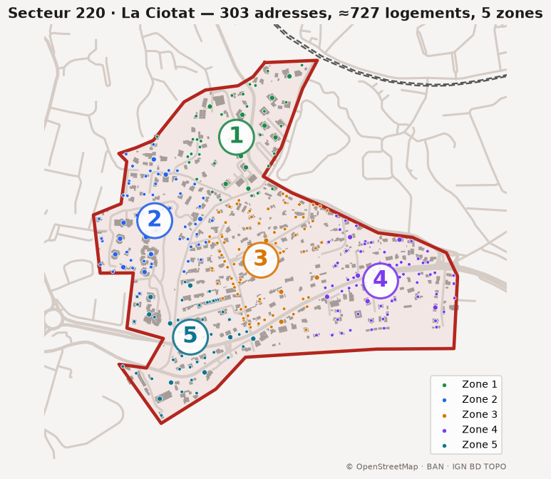

# Calendriers Pompiers La Ciotat – Secteur 220

Appli web hors ligne pour la tournée des calendriers (secteur 220, La Ciotat).

## 👉 Ouvrir l'appli : **https://chrisbiau.github.io/calendriersPompierLci/**

*Cliquez sur la carte pour ouvrir l'appli.*

## Installer sur le téléphone

1. Ouvrir le lien ci-dessus une première fois avec du réseau (Chrome sur Android, Safari sur iPhone).
2. Menu ⋮ (ou Partager) → **Ajouter à l'écran d'accueil**.
3. Dans l'appli, appuyer sur **Activer** et autoriser la localisation.

Ensuite l'appli fonctionne sans réseau. Les dons et notes restent sur le téléphone ; « Envoyer mon suivi » (onglet Bilan) permet de fusionner avec le binôme.

## Contenu

- Appli : `index.html` (GPS dans/hors secteur, suivi des adresses, dons, fusion binôme, hors ligne)
- `donnees/` : liste des adresses (CSV Excel), calque Google My Maps (KML), contour du secteur (JSON)

Sources : Base Adresse Nationale, IGN BD TOPO, © contributeurs OpenStreetMap.
